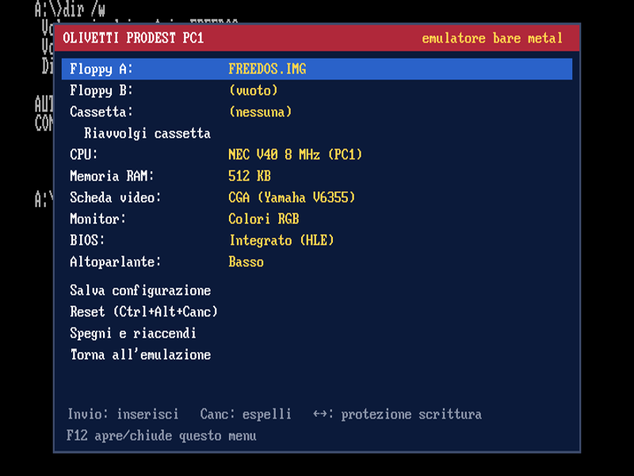

# Olivetti Prodest PC1 – emulatore bare metal per Raspberry Pi

Emulatore dell'**Olivetti Prodest PC1** che gira direttamente sul Raspberry Pi, **senza Linux**
(bare metal, con la libreria [Circle](https://github.com/rsta2/circle)). Si accende in un paio di
secondi e avvia il DOS dal floppy. Il menu **F12** permette di inserire floppy e cassette e di
scegliere CPU, RAM, scheda video, monitor e BIOS.



## ✅ Stato: funzionante

Il progetto è completo e funziona:

- **Avvia FreeDOS** dal floppy, con tastiera, grafica CGA, Hercules, beep, lettura e scrittura
  dei floppy e cassetta (scrittura e rilettura con dati identici).
- **CPU verificata**: supera 485.992 dei 486.000 test della suite SingleStepTests 8088.
- **BIOS su ROM**: con GLaBIOS il POST è senza errori e il DOS parte passando dal controller
  floppy e dal DMA emulati.
- **Kernel bare metal**: compilato per Pi 3 / Zero 2 W e Pi 4 / 400 e provato in QEMU
  (Raspberry Pi emulato): avvio, scheda SD, tastiera USB, menu F12, cambio BIOS e salvataggio
  della configurazione funzionano.

## Avvio rapido

1. Formatta una scheda micro SD in **FAT32**.
2. Copia **tutto il contenuto** della cartella `sdcard/` nella radice della scheda.
3. Collega una tastiera USB e un monitor HDMI e accendi il Raspberry Pi.
4. Parte FreeDOS dal floppy `FREEDOS.IMG`. Prova `DEMOCGA` (grafica CGA e beep) e
   `NASTRO W` / `NASTRO R` (test della cassetta).

Raspberry Pi supportati:

| Modello                    | Kernel           |
|----------------------------|------------------|
| Pi 3 B / 3 B+ / 3 A+, Zero 2 W | `kernel8-32.img` |
| Pi 4 B / 400 / CM4         | `kernel7l.img`   |

Il firmware sceglie da solo il kernel giusto (`config.txt` è già pronto).

## Il menu (F12)

| Voce | Cosa fa |
|---|---|
| **Floppy A: / B:** | Invio = sceglie un'immagine da `/prodest/floppy`, Canc = espelle, ←→ = protezione da scrittura |
| **Cassetta** | Invio = sceglie un file WAV da `/prodest/tape` oppure crea una *cassetta vuota* per registrare; Canc = espelle |
| **Riavvolgi cassetta** | Riporta il nastro all'inizio |
| **CPU** | NEC V40 8 MHz (come il PC1), Intel 8088 4,77 MHz (IBM PC), NEC V40 turbo (~32 MHz). Cambia subito |
| **Memoria RAM** | 128 / 256 / 512 / 640 KB * |
| **Scheda video** | CGA (Yamaha V6355 del PC1) oppure Hercules monocromatica * |
| **Monitor** | Colori, fosfori verdi, fosfori ambra, bianco e nero. Cambia subito |
| **BIOS** | Integrato (HLE) oppure un file ROM da `/prodest/rom` * |
| **Altoparlante** | Spento / basso / alto |
| **Salva configurazione** | Scrive `/prodest/prodest.cfg` sulla SD (viene riletto all'accensione) |
| **Reset** | Come Ctrl+Alt+Canc |
| **Spegni e riaccendi** | Riaccende la macchina applicando le voci con * |

Tasti nel menu: frecce, Invio, Esc, Canc, PagSu/PagGiù, Home/Fine.

I dischi modificati vengono salvati sulla SD automaticamente (ogni ~5 secondi, all'uscita dal
menu e quando si espelle il disco).

## File sulla scheda SD

```
/prodest/prodest.cfg      configurazione
/prodest/floppy/          immagini floppy: .IMG .IMA .DSK .360 .720 .VFD .FLP
                          (160K, 180K, 320K, 360K, 720K, 1.2M, 1.44M)
/prodest/tape/            cassette: .WAV PCM 8/16 bit, qualsiasi frequenza, mono o stereo
/prodest/rom/             ROM del BIOS: .BIN .ROM (2 KB – 256 KB, allineate a FFFFFh)
```

`cmdline.txt` accetta alcune opzioni di Circle:

- `sounddev=sndpwm` audio dal jack da 3,5 mm (predefinito), `sounddev=sndhdmi` audio via HDMI,
  `sounddev=none` audio disattivato;
- `width=1920 height=1080` forza la risoluzione del monitor se non viene rilevata bene.

## Cosa viene emulato

- **CPU**: interprete completo 8086/8088, comprese le istruzioni non documentate, più le
  estensioni 80186 del NEC V20/V40 (PUSHA, ENTER, BOUND, shift immediati…) e le sue
  particolarità (AAD/AAM ignorano l'operando, conteggio shift mascherato).
  Verificata con la suite **SingleStepTests 8088**: 485.992 test su 486.000 superati (gli 8
  restanti riguardano flag non definiti di AAM con divisione per zero).
- **Scheda madre XT**: PIC 8259, PIT 8253 (con refresh DRAM sul DMA canale 0), PPI 8255,
  tastiera XT, DMA 8237, controller floppy NEC µPD765, altoparlante.
- **Video**: CGA (testo 40/80 colonne, 320×200×4, 640×200×2, palette, bordo, lampeggio,
  registro di stato per i programmi che evitano lo "snow") e Hercules (testo 80×25 a 9×14 e
  grafica 720×348 a due pagine).
- **Floppy**: due unità, scrittura su SD.
- **Cassetta**: formato IBM PC (FSK 1 ms / 0,5 ms, blocchi da 256 byte con CRC). Con il BIOS
  integrato funzionano INT 15h AH=00-03 (lettura e scrittura). Con una ROM esterna il segnale
  arriva sulla porta 62h bit 4, con il motore comandato dalla porta 61h bit 3, come sull'IBM 5150.
- **Tastiera USB**: mappata per posizione sui tasti XT. Per la tastiera italiana basta
  `KEYB IT` nel DOS. Funzionano i LED di Bloc Maiusc/Num/Scorr, Alt+tastierino per i codici
  ASCII e Ctrl+Alt+Canc.

### BIOS integrato

Il BIOS integrato è scritto da zero (nessun codice IBM o Olivetti). La ROM contiene solo i punti
di ingresso agli indirizzi standard (F000:E05B, FE6E, FEA5, FA6E font…). I servizi (INT 10h,
13h, 15h, 16h, 1Ah, 08h, 09h…) sono implementati nell'emulatore tramite un'istruzione trap.
Avvia MS-DOS, PC-DOS e FreeDOS.

### BIOS su ROM

Con **BIOS → ROM** la macchina parte dalla ROM scelta e tutto passa dall'hardware emulato
(controller floppy, DMA, timer…). È verificato con **GLaBIOS** (BIOS XT open source, GPLv3,
incluso in `/prodest/rom`): il POST è senza errori, rileva il V20, e da lì avviano FreeDOS e
vanno lettura e scrittura su floppy.

## Limiti noti (da sapere)

- **ROM originale del PC1**: non è inclusa (è protetta da copyright) e non l'ho potuta provare.
  Questo emulatore riproduce un XT standard. Non sono emulate le particolarità del PC1: i modi
  extra del chip video Yamaha V6355 (160×200 a 16 colori, registri palette) e le periferiche
  interne del V40 rilocabili. La ROM originale potrebbe quindi fermarsi durante il POST.
  Il BIOS integrato invece funziona.
- **Cassetta**: il PC1 vero **non ha la porta cassetta**. È stata aggiunta in stile IBM 5150,
  come richiesto.
- I modi EGA/VGA non ci sono (come sul PC1). Mancano porte seriali e parallela, disco fisso e
  mouse.
- **Prove su hardware**: il kernel è compilato per Pi 3 e Pi 4 ed è stato provato nell'emulatore
  QEMU (Raspberry Pi Zero emulato): avvio, SD, tastiera USB, menu, ROM esterna e salvataggio
  della configurazione. Non è stato provato su un Raspberry Pi fisico. L'audio (PWM/HDMI) non
  esiste in QEMU, quindi non è stato provato.

## Compilare dai sorgenti

Servono `arm-none-eabi-gcc` (Ubuntu/Debian: `sudo apt install gcc-arm-none-eabi`), `make`,
`git` e `python3`. `nasm` serve solo se si modifica `core/biosrom.asm`.

```sh
git clone https://github.com/rsta2/circle.git
cd circle
./configure -r 3 -p arm-none-eabi-        # -r 4 per Raspberry Pi 4
./makeall --nosample
make -C addon/SDCard && make -C addon/fatfs
cd ../prodest-pc1/pi
make CIRCLEHOME=../../circle              # produce kernel8-32.img (o kernel7l.img)
```

Per cambiare modello di Pi, riconfigura Circle (`./configure -r N -f`) e ricompila **sia Circle
sia i suoi addon** (`make clean` in `addon/SDCard` e `addon/fatfs`), poi cancella gli oggetti in
`pi/` e `core/`.

### Prove su PC (Linux)

Il core è portabile, quindi si può provare anche senza Raspberry:

```sh
make -f Makefile.host
./prodest_host --root sdcard --frames 900 --type 600 "dir
" --text --ppm schermo.ppm
```

`sst_test` esegue la suite SingleStepTests 8088 (converti prima i JSON con
`tools/sst_convert.py`).

## Struttura

```
core/        emulatore portabile (C++ freestanding, nessuna libreria)
  cpu.*        CPU 8088 / NEC V20-V40
  machine.*    memoria, I/O, PIC, PIT, PPI, tastiera, DMA, audio, cassetta
  fdc.cpp      controller floppy µPD765
  video.cpp    CGA / Hercules
  hlebios.cpp  BIOS integrato (servizi)
  biosrom.asm  BIOS integrato (ROM con i punti di ingresso) -> biosrom.h
  ui.*         menu F12, gestione floppy/cassette/ROM, configurazione
pi/          kernel bare metal per Circle (video, tastiera USB, audio, SD)
host/        harness di prova per Linux e test della CPU
sdcard/      contenuto pronto da copiare sulla scheda SD
tests/       programmi DOS di prova (nasm)
```

## Licenze

- Questo progetto: **GPLv3** (come Circle).
- Circle © R. Stange, GPLv3.
- Font 8×8 e 8×14 da DOSBox Staging (GPL-2.0-or-later).
- GLaBIOS © 640KB, GPLv3. Compilato con JWasm dai sorgenti ufficiali, con due sole correzioni
  di sintassi per l'assemblatore.
- FreeDOS (immagine floppy di esempio): GPL, sorgenti su freedos.org.
- Firmware Raspberry Pi (`bootcode.bin`, `start*.elf`, `fixup*.dat`): licenza Broadcom, vedi
  `LICENCE.broadcom`.
